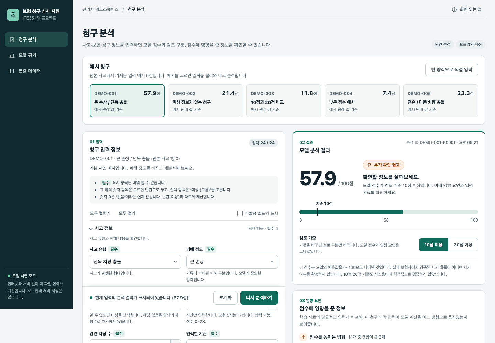
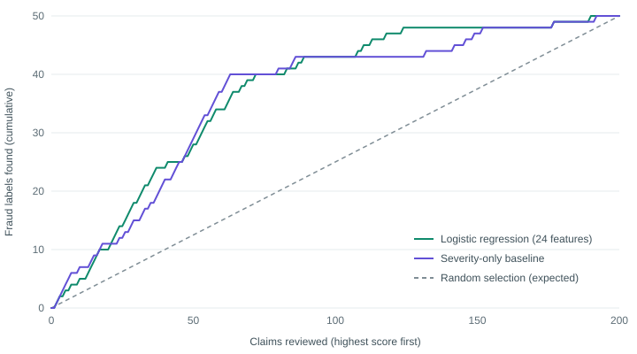

# Predictive Analytics for Auto Insurance Fraud Detection: A Machine Learning Benchmark and Resource Optimization Study

> **Blog in progress** — ITE351 group project (Option A), draft of 22 November 2026.
> Sections I, II and IV describe what we have done so far. Sections III, V and VI are outlines that we will complete as the remaining experiments finish.

## Members

| Name | Department | Email |
|---|---|---|
| 김일 | 정보시스템학과, 한양대학교 | kimyir2@gmail.com |
| 양희원 | 정보시스템학과, 한양대학교 | hwyang0627@gmail.com |
| 정남주 | 정보시스템학과, 한양대학교 | namjoo2222@naver.com |
| 정진규 | 사회학과, 한양대학교 | jjg2035@naver.com |

## I. Proposal (Option A)

### Motivation: why are we doing this?

Insurance fraud detection is usually framed as a classification problem and judged by accuracy or F1. In practice an insurer cannot investigate every claim. Investigators are limited, and every flagged claim takes their time. The question that matters operationally is therefore not only "is this claim fraudulent?" but also "if we can look closely at only K claims, which ones should we look at first, and how many fraudulent claims will we find among them?"

This project studies auto insurance fraud detection from that resource-constrained point of view. We benchmark standard classifiers on a public Kaggle dataset, then use the model scores to rank claims and compare top-K priority inspection with random selection. We also look at how missing values are handled, because several fields in our dataset contain unknown entries and the way they are treated can change which claims get flagged.

### What do we want to see at the end?

1. A benchmark of several classifiers (SVC, Random Forest, XGBoost, LightGBM, with logistic regression as a transparent baseline) using precision, recall and F1.
2. An evaluation of top-K% inspection strategies (for example the top 5%, 10% and 20% of claims) with cumulative gain curves compared against random sampling.
3. An analysis of how different missing-value handling methods affect false positives.
4. A small review-support dashboard that shows how a model score could be used by a claims reviewer: the score, a review recommendation, the inputs that moved the score, and the reviewer's own note.

### Where we are now

| Item | Status |
|---|---|
| Data preparation and preprocessing for 24 features | First version done |
| Logistic regression and a severity-only baseline | Done |
| Repeated cross-validation with top-K and threshold analysis | First version done (Section IV) |
| Review-support dashboard prototype | Working prototype (Section III) |
| Additional classifiers (SVC, Random Forest, XGBoost, LightGBM) | Planned in the proposal **[TODO: update status]** |
| Comparison of missing-value handling methods | Planned in the proposal **[TODO: update status]** |

## II. Datasets

We use the public Kaggle dataset *Auto Insurance Claims Data*: [https://www.kaggle.com/datasets/buntyshah/auto-insurance-claims-data](https://www.kaggle.com/datasets/buntyshah/auto-insurance-claims-data)

- The data has 1,000 claims, one row per claim.
- Each claim carries a fraud label recorded in the dataset. 247 claims (24.7%) are labeled as fraud and 753 are not.
- So far we use 24 input features: 13 numeric (5 of them integer-valued) and 11 categorical. They are listed in Table 1. **[TODO: describe the remaining columns of the raw file and why they are not used yet.]**

*Table 1. The 24 input features used so far.*

| Group | Feature | Type | Values in the 1,000 rows |
|---|---|---|---|
| Accident | `incident_type` | categorical | Multi-vehicle Collision, Parked Car, Single Vehicle Collision, Vehicle Theft |
| Accident | `incident_severity` | categorical | Major Damage, Minor Damage, Total Loss, Trivial Damage |
| Accident | `collision_type` | categorical | Front Collision, Rear Collision, Side Collision; plus *unknown* |
| Accident | `incident_hour_of_the_day` | integer | 0 to 23 (median 12) |
| Accident | `number_of_vehicles_involved` | integer | 1 to 4 (median 1) |
| Accident | `authorities_contacted` | categorical | Ambulance, Fire, None, Other, Police |
| Claim amounts | `injury_claim` | numeric | 0 to 21,450 (median 6,775) |
| Claim amounts | `property_claim` | numeric | 0 to 23,670 (median 6,750) |
| Claim amounts | `vehicle_claim` | numeric | 70 to 79,560 (median 42,100) |
| Scene and evidence | `bodily_injuries` | integer | 0 to 2 (median 1) |
| Scene and evidence | `witnesses` | integer | 0 to 3 (median 1) |
| Scene and evidence | `property_damage` | categorical | NO, YES; plus *unknown* |
| Scene and evidence | `police_report_available` | categorical | NO, YES; plus *unknown* |
| Policy | `months_as_customer` | integer | 0 to 479 (median 199.5) |
| Policy | `policy_csl` | categorical | 100/300, 250/500, 500/1000 |
| Policy | `policy_deductable` | numeric | 500 to 2,000 (median 1,000) |
| Policy | `policy_annual_premium` | numeric | 433.33 to 2,047.59 (median 1,257.2) |
| Policy | `umbrella_limit` | numeric | -1,000,000 to 10,000,000 (median 0) |
| Insured profile | `insured_sex` | categorical | FEMALE, MALE |
| Insured profile | `insured_education_level` | categorical | Associate, College, High School, JD, MD, Masters, PhD |
| Insured profile | `insured_occupation` | categorical | 14 categories (adm-clerical, armed-forces, craft-repair, ...) |
| Insured profile | `insured_relationship` | categorical | husband, not-in-family, other-relative, own-child, unmarried, wife |
| Insured profile | `capital-gains` | numeric | 0 to 100,500 (median 0) |
| Insured profile | `capital-loss` | numeric | -111,100 to 0 (median -23,250) |

### Things we noticed in the data

- **Unknown values.** Three features contain unknown entries: `collision_type` in 178 of the 1,000 rows (17.8%), `property_damage` in 360 (36.0%) and `police_report_available` in 343 (34.3%). We keep *unknown* as its own category instead of replacing it with a guessed value.
- **"None" is not missing.** `authorities_contacted` has a category `None`, which means that no authority was contacted. That is real information, so we keep it separate from missing values. In the same way, a numeric 0 (for example zero witnesses) is a value and is not treated as blank.
- **Units.** Claim amounts, premium, deductible, umbrella limit and capital gains or losses are in the dataset's original units. We do not convert them to KRW.
- **Signs.** `capital-loss` is stored as a negative number (from -111,100 to 0).
- **A value to verify.** `umbrella_limit` has a minimum of -1,000,000, which is hard to read as a coverage limit. We have not altered it and note it here as something to check.
- **Size.** With 1,000 rows every estimate is noisy. All results in Section IV should be read with this in mind.

The fraud label is the label that comes with the dataset. We take it as given and cannot verify how it was assigned.

## III. Methodology (outline)

This section is still being written. The following parts are already fixed.

- **Preprocessing.** For numeric features, missing values are filled with the training median and the feature is standardized with the training mean and standard deviation. Categorical features get one coefficient per category, with *unknown* as a separate category where it occurs.
- **Models so far.** (1) Logistic regression on the 24 features. It is a transparent starting point: its score decomposes exactly into per-feature contributions in log-odds. (2) A baseline that uses only `incident_severity`.
- **Evaluation protocol.** 5-fold cross-validation repeated 3 times, which gives 15 train/test runs. Each run trains on 800 claims and tests on the other 200. Claims in the test fold are ranked by predicted score, and we count how many fraud labels fall in the top K.
- **To be added.** SVC, Random Forest, XGBoost and LightGBM, their hyperparameters, and the missing-value handling variants. **[TODO]**

### Prototype: a review-support dashboard

We built a single-file, offline dashboard (HTML, CSS and JavaScript; no server). A reviewer enters the 24 fields of one claim and gets a model score on a 0 to 100 scale, a review recommendation against a threshold (10 or 20), the inputs that moved the score up or down as log-odds contributions, a record of how unknown inputs were handled, and a place to write their own judgment and note.

- The logistic regression in the dashboard is trained on all 1,000 claims. Its JavaScript implementation reproduces the Python model's predictions on all 1,000 rows (maximum absolute difference about 2.8e-16).
- Numeric inputs outside the range seen in training are scored at the nearest bound of that range and flagged. Without this, a linear model extrapolates and the score collapses to nearly 0 or 100.
- The score is a model output, not a verified probability of fraud, and the dashboard says so on screen. The reviewer's judgment and note never change the score.

*Figure 1. Claim analysis view of the dashboard prototype (the interface is in Korean). Left: the claim inputs. Right: the model score, the review threshold and the recommendation.*

## IV. Evaluation & Analysis

All numbers below come from cross-validation predictions on claims that the model did not see during training. They are computed on three different scopes, and we name the scope each time.

- **Scope A** is one evaluation fold: 200 test claims, 50 of them labeled fraud.
- **Scope B** is the first repeat of cross-validation: out-of-fold predictions for all 1,000 claims, 247 of them labeled fraud.
- **Scope C** is the mean over all 15 runs, with 200 test claims per run.

### 1. How many fraud labels are in the top K? (Scope C)

We rank the 200 test claims by score, select the top K, and count the fraud labels among them. Random selection is expected to find K × 24.7%.

*Table 2. Fraud labels among the K highest-scored claims, mean over 15 runs.*

| Claims selected (K) | Share of test fold | Logistic regression (24 features) | Severity-only baseline | Random selection (expected) |
|--:|--:|--:|--:|--:|
| 10 | 5% | 6.00 (60.0%) | 6.07 (60.7%) | 2.47 |
| 20 | 10% | 12.20 (61.0%) | 11.80 (59.0%) | 4.94 |
| 40 | 20% | 24.20 (60.5%) | 24.27 (60.7%) | 9.88 |
| 60 | 30% | 32.93 (54.9%) | 33.47 (55.8%) | 14.82 |

The percentage in parentheses is the share of the selected claims that are labeled fraud (precision in the top K).

Selecting the 40 highest-scored claims out of 200 captures about 24 fraud labels, where random selection would be expected to find about 10. For K up to 40 both models find roughly 2.4 to 2.5 times as many as random selection, and 2.2 to 2.3 times at K = 60. The two models are practically indistinguishable: 24.20 against 24.27 at K = 40.

### 2. Cumulative gain on one fold (Scope A)

*Figure 2. Fraud labels found when the 200 test claims of one fold are reviewed from the highest score down.*

*Table 3. Values read from Figure 2.*

| Claims reviewed | Logistic regression (24 features) | Severity-only baseline | Random selection (expected) |
|--:|--:|--:|--:|
| 10 | 5 | 7 | 2.5 |
| 20 | 10 | 11 | 5.0 |
| 40 | 24 | 22 | 10.0 |
| 60 | 34 | 37 | 15.0 |
| 100 | 43 | 43 | 25.0 |
| 200 | 50 | 50 | 50.0 |

The lead changes three times along the curves. The severity-only baseline produces only four distinct scores, so the order inside each group of tied claims is arbitrary (we use the order recorded with the evaluation data). A single fold should not be over-read.

### 3. Thresholds instead of a fixed K (Scope B, logistic regression)

*Table 4. Flagging every claim whose predicted score is at or above a threshold, on the 1,000 out-of-fold predictions of the first repeat.*

| Threshold | Claims flagged | Fraud labels found (TP) | Not labeled fraud (FP) | Fraud labels missed (FN) | Precision | Recall | F1 |
|--:|--:|--:|--:|--:|--:|--:|--:|
| 0.10 | 609 | 209 | 400 | 38 | 34.3% | 84.6% | 0.488 |
| 0.20 | 363 | 175 | 188 | 72 | 48.2% | 70.9% | 0.574 |
| 0.50 | 200 | 121 | 79 | 126 | 60.5% | 49.0% | 0.541 |

Lowering the threshold from 0.20 to 0.10 flags 246 more claims (363 to 609) and finds 34 more fraud labels (175 to 209), but 212 of the additional claims are not labeled fraud. Which point is right depends on how many claims the investigators can handle, which is the trade-off this project is about. The dashboard offers 10 and 20 on its 0 to 100 scale, which correspond to thresholds 0.10 and 0.20. They are demonstration settings, not tuned values.

### 4. Why do the two models perform the same? (Scope A)

We grouped the 200 test claims of one fold by `incident_severity`.

*Table 5. One evaluation fold by incident severity.*

| Incident severity | Test claims | Labeled fraud | Logistic regression score (median, range) | Severity-only score |
|---|--:|--:|--:|--:|
| Major Damage | 63 | 40 (63.5%) | 0.530 (0.191 to 0.852) | 0.588 |
| Total Loss | 55 | 3 (5.5%) | 0.144 (0.031 to 0.463) | 0.148 |
| Minor Damage | 66 | 6 (9.1%) | 0.081 (0.021 to 0.251) | 0.113 |
| Trivial Damage | 16 | 1 (6.3%) | 0.056 (0.015 to 0.134) | 0.080 |

1. **Fraud labels are concentrated in one severity level.** 40 of the 50 fraud labels in this fold (80%) are Major Damage claims. 63.5% of Major Damage claims are labeled fraud, against 5.5% to 9.1% for the other levels.
2. **The 24-feature model also puts Major Damage claims first.** Its 40 highest-scored claims are all Major Damage claims.
3. **Its ordering inside that level did not help.** Those 40 claims contain 24 fraud labels (60.0%), which is not higher than the 63.5% rate of the whole Major Damage group. The order inside one severity level is decided by the other 23 features.
4. **The baseline gives all 63 Major Damage claims the same score.** Picking 40 of them can yield anywhere from 17 to 40 fraud labels depending on which tied claims are taken. The recorded order gives 22.

So both models select the same kind of claim first, and the number of fraud labels in the top K comes out nearly the same. The 24-feature model does give every claim its own score (200 distinct scores in this fold, against 4 for the baseline) and an explanation of which inputs moved it. On this evaluation data, however, we have no evidence that it finds more fraud labels than the one-feature baseline.

### 5. What this means and what is next

- A one-feature baseline is hard to beat on this dataset. We plan to compare every further model with the severity-only baseline and not only with random selection.
- The useful question for the remaining models is whether they can rank claims inside the Major Damage group better than chance.
- The results we have so far are means over 15 runs. We will add the spread across runs before reading anything into small differences.
- The precision, recall and F1 benchmark across classifiers and the comparison of missing-value handling methods are still to come. **[TODO]**

**Limitations so far.** The same 1,000 claims are re-split many times, so this is not a test on new data. The fraud label is the dataset's label and not the outcome of an investigation. Scores are model outputs and not calibrated probabilities. We cannot yet tell whether the other 23 features carry little signal or whether 1,000 rows are too few to find a weak one.

## V. Related Work (to be written)

Tools used so far: Python for the modeling **[TODO: list the libraries]**. The dashboard is plain HTML, CSS and JavaScript built into a single file by a script that uses only the Python standard library, and its behavior is checked with Node.js and headless Chrome.

**[TODO: add the papers, blogs and documentation we relied on.]**

## VI. Conclusion: Discussion (to be written)

To be written after the benchmark is complete. A preliminary observation is that, for deciding which claims to review first, the severity of the incident carries most of the signal in this dataset, and a more complex model has to prove its value against that simple rule.
